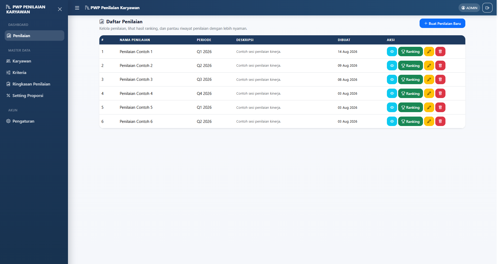
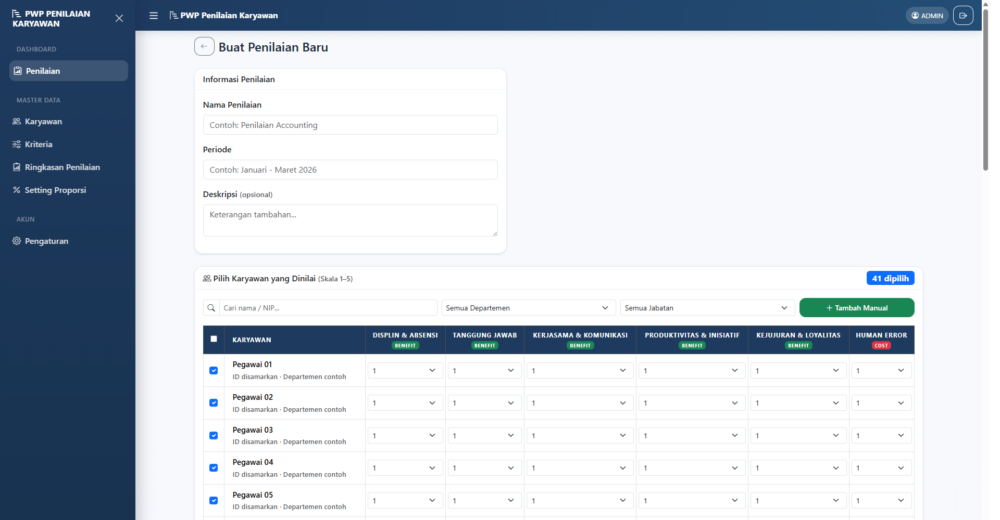
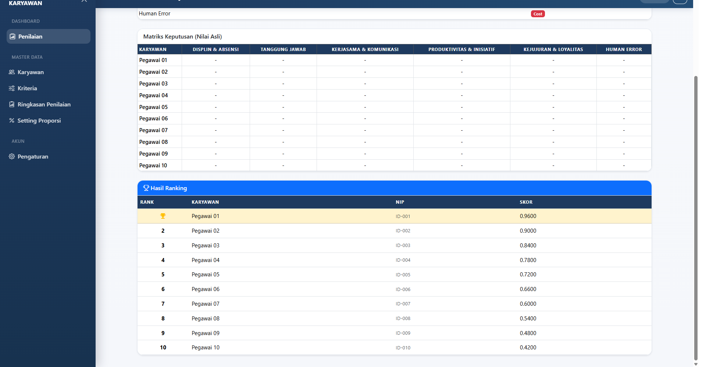
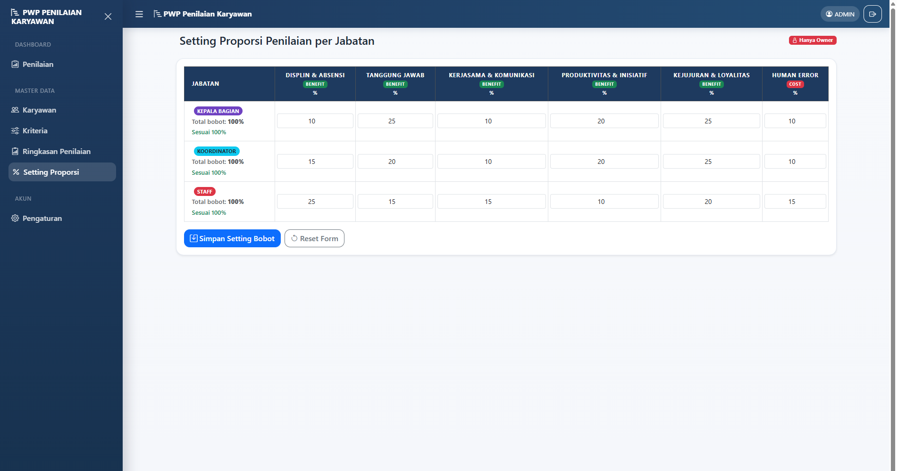

# PWP Penilaian Karyawan

Aplikasi untuk mengelola penilaian kinerja pegawai. Penilaian disusun berdasarkan kriteria dan dihitung dengan metode TOPSIS untuk menghasilkan ranking.

## Tampilan dan fitur

Screenshot di bawah memakai data contoh. Nama, identitas, dan skor pegawai pada gambar hasil penilaian sudah disamarkan.

### Daftar penilaian

Buat dan kelola sesi penilaian, lihat detailnya, atau buka hasil ranking.



### Form penilaian

Isi nama dan periode penilaian, pilih pegawai berdasarkan departemen atau jabatan, lalu beri nilai 1–5 untuk setiap kriteria.



### Hasil ranking

Lihat matriks nilai dan urutan hasil perhitungan TOPSIS untuk pegawai yang dinilai.



### Setting proporsi

Owner dapat mengatur bobot kriteria untuk tiap jabatan. Total bobot ditampilkan agar mudah dipastikan berjumlah 100%.



### Menu lainnya

- **Karyawan**: mengelola data pegawai.
- **Kriteria**: mengatur kriteria, jenis benefit atau cost, dan bobot dasar.
- **Ringkasan Penilaian**: melihat ringkasan sesi penilaian.
- **Pengaturan**: memperbarui nama akun dan password.

## Menjalankan aplikasi

Pastikan PHP 8.2, Composer, Node.js, dan npm sudah terpasang. Salin `.env.example` menjadi `.env`, lalu sesuaikan pengaturan database.

```bash
composer install
php artisan key:generate
php artisan migrate
npm install
npm run build
php artisan serve
```

Buka alamat yang ditampilkan oleh `php artisan serve` di browser. Saat mengembangkan frontend, jalankan `npm run dev`.

## Pengujian

```bash
php artisan test
```